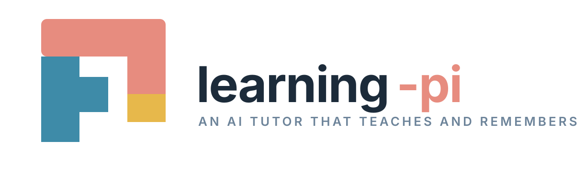

<p align="center">
  
</p>

# learning-pi

An AI tutor that teaches by interrogating what you already know, then remembers it. The runtime is pi skills, subagents, and a verification gate. The learner notebook is `state/`. Both live in this one repo, and the history is included.

## What it is

- **You bring the material and a closed-book model.** `/teach <topic>` and `/lesson` never open with a cold lecture. The Tutor asks for your notes and your own explanation first, triages it, and attacks one hole at a time. When your own repair fails, it teaches that one gap one checked step at a time. It cannot move on until you pass a fresh check and restate the gap yourself.
- **You can also just bring your thinking.** `/critique` takes your own-words model, or a source excerpt plus your interrogation, and returns one quoted diagnosis. It names what is right, wrong, vague, missing, or overreaching, and hands the next version back to you. No triage, no attack battery, no clone.
- **It cannot bluff you.** Independent verifiers fact-check every teaching claim before you see it. Unverified text is withheld. Verifier issues block at any severity. Source and review flags can surface as banners instead of blocking. Normal, non-learning chats are never gated.
- **It remembers.** What you learn becomes review cards on a schedule (`/review`). Mistakes jump the queue, and your own explanations accumulate into a personal wiki.
- **Your data is files.** Sessions, concepts, and the wiki are Markdown and JSON in a git repo you own. There is no database and no lock-in.

A plain-language walkthrough of a session is in [FIELD-GUIDE.md](FIELD-GUIDE.md), sections 3 to 5. The method and what it borrows are in [docs/teaching-methodology.md](docs/teaching-methodology.md).

## Quick start

```bash
git clone https://github.com/delightaheebwa/learning-pi.git ~/learning-pi
~/learning-pi/install.sh ~/learning-pi/state
cd ~/learning-pi/state && pi   # approve/trust the project once, then /review /lesson /teach
```

Define your track in `state/Learning System/MISSION.md` and `state/Learning System/CURRICULUM.md`, then run `/teach <topic>` or `/lesson`.

You need `git`, `python3`, and `mise` for the pinned `pi`, plus `node`, `npm`, and `deno` for updates and tests. [docs/setup.md](docs/setup.md) has idempotent setup blocks for Omarchy, Arch, Ubuntu, Debian, WSL, Windows WSL2, and macOS, along with PATH and SSH notes.

## Two ways to use it

- **pi in the terminal.** Run `pi` from `state/`. It suits quick sessions and needs no browser or Docker.
- **Open WebUI via `pi-bridge`.** Browser chat with images and history. It runs on Linux with Docker. See [deploy/README.md](deploy/README.md).

Both drive the same Tutor and the same notebook. The bridge runs real shell commands through pi. Keep it keyed and local at `172.17.0.1:8790`, never `0.0.0.0`. Keep secret files at mode 600 and treat backups as secrets. Web search is on by default with keyless DuckDuckGo, so queries leave the machine. See [deploy/SECURITY.md](deploy/SECURITY.md).

## Day to day

Commands are the same in both modes: `/teach <topic>`, `/lesson`, `/continue`, `/pause`, `/review`, `/solo` (an AI-free closed-book check), `/read` (a reading session with a benchmark), `/critique` (diagnose your own model or your interrogation of a text), `/ingest [content]`, `/audit`.

### With pi in the terminal

Run `pi` from `state/` and approve trust once. The `.pi/` resources load only there. Run `/reload` or restart pi after any update. A live session keeps the gate logic it loaded at startup.

### With Open WebUI

The browser face drives the same Tutor through `pi-bridge`, and Open WebUI holds only chat transcripts. Restart the bridge service and the `deploy/` compose stack after any update. `webui.db` holds users, chats, and the bridge key, so back it up and keep it private. See [FIELD-GUIDE.md](FIELD-GUIDE.md), sections 8 to 9.

Both modes share the same rules. Never run two state-writing sessions at once. A lesson auto-ingests at the end, so run `/ingest` yourself only after `/pause`. Do not commit `.pi/`, `Pending Ingest.json`, or `.tmp/`.

State lives in the `state/` git history, and gate receipts live under `~/.pi/agent/learning-gate/`.

Models are assigned in `.pi/settings.json` at project scope. The keys those providers need are configured in pi, not in this repo. Verifier separation is a preference, not a guarantee. If a preferred model is unavailable, a verifier may run on the Tutor's model. An optional judge needs `GEMINI_API_KEY`. If the judge is unavailable or rate-limited, the gate falls back to its deterministic path. The model table is in [FIELD-GUIDE.md](FIELD-GUIDE.md), section 7.

## Updating safely

`bin/pi` runs the version pinned in `versions.lock.json` and never updates anything. Only `lpi update` promotes a candidate, and only after it passes the contract gate:

```bash
lpi                   # what's newer, read-only
lpi update            # stage, gate, promote or diagnose (alias: lpi up)
lpi test              # gate behavior, golden, resources, load probe
lpi doctor            # re-test the current pins
lpi rollback          # undo the last promotion (alias: lpi rb)
man lpi               # full reference
```

Behavior is declared in [CONTRACT.md](CONTRACT.md) and `contracts/learning-core.json`, and checked by `scripts/learn-check`. A failed update stays pinned and writes a diagnosis under `~/.cache/learning-pi/`. A weekly timer audits gate provenance. See [bin/README.md](bin/README.md) and [harness/README.md](harness/README.md).

## Docs

| Topic | Where |
| --- | --- |
| Setup per platform, PATH, clone and SSH notes | [docs/setup.md](docs/setup.md) |
| Every doc, source of truth, and reading order | [docs/README.md](docs/README.md) |
| Daily flows, gate banners, troubleshooting, models | [FIELD-GUIDE.md](FIELD-GUIDE.md) |
| Teaching method and what it deliberately does not import | [docs/teaching-methodology.md](docs/teaching-methodology.md) |
| Behavior guarantees and the two change doors | [CONTRACT.md](CONTRACT.md) |
| Engineering bar | [CONSTRAINTS.md](CONSTRAINTS.md) |
| Learner state layout | [state/README.md](state/README.md) |
| Bridge, deployment, security | [bridge/README.md](bridge/README.md), [deploy/README.md](deploy/README.md), [deploy/SECURITY.md](deploy/SECURITY.md) |

Questions, ideas, show-and-tell, and the build log are in the project's [Discussions](https://github.com/delightaheebwa/learning-system/discussions). That link stays at the former repo's URL because it is still the community hub. This project is built in public.

## Uninstall

Remove the local overlay with `rm -rf ~/learning-pi/state/.pi`. To tear down the optional web stack, follow the rollback steps in [deploy/README.md](deploy/README.md). Running `docker compose down -v` deletes `webui.db`.
