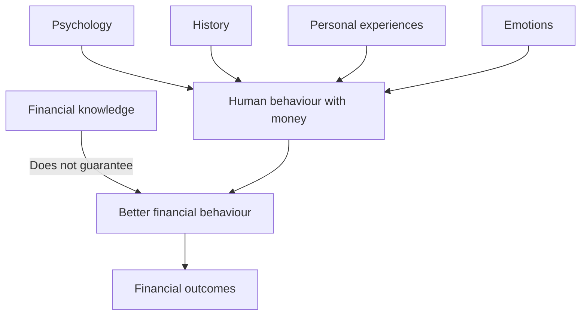

<!-- source: learner-supplied — a self-authored mental model (Mermaid) + three verbatim passages quoted from Morgan Housel, *The Psychology of Money: Timeless Lessons on Wealth, Greed, and Happiness*, Introduction. The chapter PDF was attached in-session; it is NOT stored in this repo. | type: learner-note + book-excerpt (as supplied) | fetched: 2026-11-24 -->

# 2026-11-24 — psychology-of-money — Housel, Introduction (learner-supplied)

## Learner's mental model (verbatim, as supplied)

## Verbatim passages quoted from the Introduction

1. > "financial success is not a hard science. It's a soft skill, where how you behave is more important than what you know."
   — finance is overwhelmingly taught as a math-based field (data into a formula tells you what to do), but the soft skill — the psychology of money — is greatly underappreciated. This grounds the `FK --> FB` "does not guarantee" edge.

2. > "Your personal experiences with money make up maybe 0.00000001% of what's happened in the world, but maybe 80% of how you think the world works."
   — personal experience shapes beliefs, goals, and forecasts; equally smart people disagree about recessions, investing, risk, because of different equally persuasive experiences. This grounds `EXP --> HB`.

3. > "every financial decision a person makes, makes sense to them in that moment and checks the boxes they need to check. They tell themselves a story about what they're doing and why they're doing it, and that story has been shaped by their own unique experiences."
   — behaviour is story-driven, not knowledge-driven. This grounds `HB --> FB --> OUT`.

## Provenance limits

- The three passages are reproduced exactly as the learner's session supplied them; they were not re-fetched from the book in this ingest.
- The chapter body was not otherwise read, so no claim in the wiki layer rests on Housel's wording beyond these three quotations.
- The `PSY`, `HIS` and `EMO` edges are the learner's own added structure — the three quoted passages support `EXP --> HB`, `FK --> FB` (negated) and `HB --> FB --> OUT` only.
