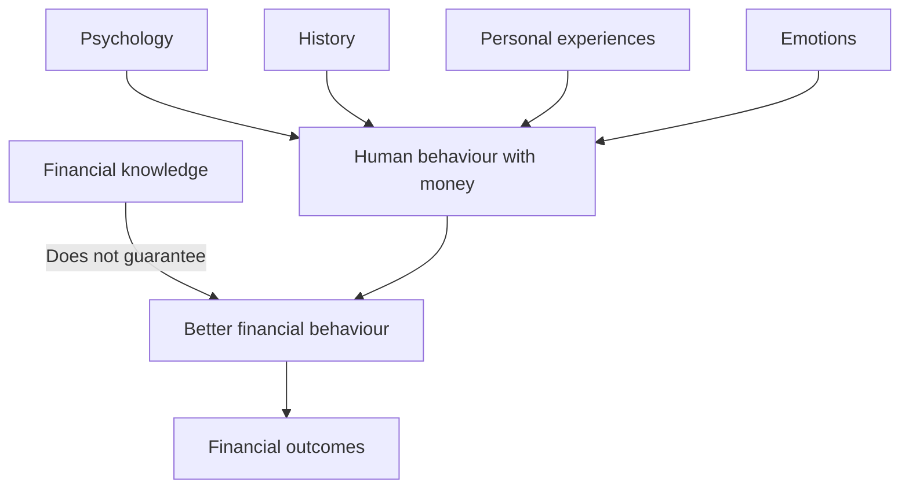

<!-- provenance: status=synthesis | source=raw/sources/2026-11-24 - psychology-of-money - housel-introduction.md (learner-supplied model + Housel, Introduction — three verbatim passages as supplied in-session) | verified-by=— | date=2026-11-24 | the `## My understanding` block is status=learner-note (the learner's Mermaid model, verbatim) -->
# Psychology of Money (soft skill)

**Insight:** financial outcomes are dominated by **behaviour**, not by technical knowledge — doing well with money is a soft skill, and knowing the maths does not guarantee acting on it.

## The claim

- Housel's Introduction states it directly: *"financial success is not a hard science. It's a soft skill, where how you behave is more important than what you know."*
- Finance is overwhelmingly **taught** as a math-based field: put the data into a formula and the formula tells you what to do. That framing is fine as arithmetic and incomplete as a causal account of outcomes, because the person executing the formula is a term the formula does not contain.
- The psychology of money — the soft skill — is therefore *underappreciated* relative to the maths. The same spreadsheet in two hands produces two different lifetimes of outcomes.
- Behaviour is **hard to teach, even to very smart people**. The difficulty is not information intake; more information does not discharge it.

## The knowledge → behaviour arrow is not an implication

- The learner's model labels the `Financial knowledge → Better financial behaviour` edge **"Does not guarantee"** — the correct logical strength. The relation is an implication in neither direction: knowledge is not *sufficient* (people who know the theory still act against it) and not strictly *necessary* (people without the theory can behave well by temperament or imitation).
- The sharper form: a **soft skill** is one whose execution is not discharged by knowing its rules. Knowing the rule is at most a precondition for the good behaviour, never a substitute for it.

## What this is not

- **Not** "knowledge doesn't matter". The source claim is comparative weight — *"more important than what you know"* — not zero weight. Fee arithmetic, tax treatment and compounding are computable, and there knowledge genuinely decides the answer.
- **Nearest-neighbour contrast — financial literacy:** financial literacy is a *knowledge* variable (do you know what a fee does, what a bond is). The psychology-of-money claim is about the *behaviour* variable that sits **between** literacy and outcome. Two people of equal literacy and different behaviour diverge; that divergence is this page's object, and financial literacy has nothing to say about it.
- **Failure regime:** the claim is scoped to multi-decade, personally-executed, emotionally loaded decisions — saving, investing, holding through a drawdown. In a single-shot, fully specified, fee-free computation the behaviour term shrinks toward zero and the knowledge term dominates. Applying "it's just psychology" to a calculable arithmetic question is the misapplication to watch for.

## What the model adds around the claim

- **`HB → FB → OUT`:** behaviour is the channel, outcomes the read-out. Outcomes are therefore **evidence about behaviour**, not directly about knowledge — a person can be wrong about the theory and still do well, which is exactly why knowledge cannot be read back off results.
- **`FK → FB` negated** rather than absent: the model keeps finance knowledge in the picture and denies it the guarantee, rather than deleting the variable.
- **`PSY`, `HIS`, `EMO → HB`:** the learner routes psychology, history and emotions into behaviour. The three quoted passages do not individually evidence those three edges — they support `EXP → HB`, the negated `FK → FB`, and `HB → FB → OUT`. Treated here as the learner's added structure, not as source claims.

## My understanding
> status=learner-note — the learner's own model, verbatim, 2026-11-24 (a Mermaid flowchart, reproduced exactly; not rewritten).

**Source framing:** the `FK → FB` edge's "Does not guarantee" label is the sentence *"how you behave is more important than what you know"* read as a relation between two variables rather than as a slogan.

**External angle — what the model leaves out:** nothing in the flowchart distinguishes *which* behaviours carry the outcome (saving rate, holding period, cost discipline) from behaviour in general, and nothing yet marks the failure regime where the knowledge term dominates. [[Personal Experience Shapes Financial Beliefs]] carries the mechanism behind `EXP → HB` (the 0.00000001% / 80% asymmetry) and the story-driven account of a decision that "checks the boxes they need to check".

## Notes

- **Source limits:** one chapter (the Introduction) read; three quotations supplied verbatim in-session; the PDF is not in this repo, so the wiki layer cites the passages, not the book.
- **Open questions:** (a) if behaviour is a soft skill, what actually moves it — imitation, feedback, constraints, or nothing teachable? The Introduction names the difficulty and does not answer it. (b) The claim is a comparative weight, not a measurement; nothing here says how the behaviour term would be estimated.
- **Cross-links:** [[Personal Experience Shapes Financial Beliefs]] · the source note above.
